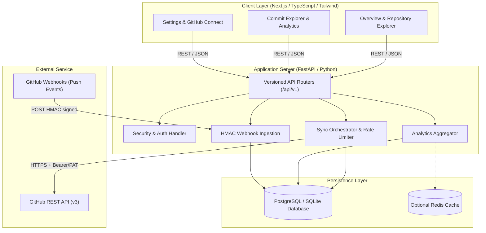

# System Architecture: GitPulse Analytics Dashboard

## Architectural Layers

### 1. Frontend Presentation Layer
- **Framework**: Next.js 14+ (App Router) or modern React with TypeScript.
- **Design System**: Tailwind CSS with custom slate/indigo developer theme, Lucide React icons, and Recharts visualization.
- **Data Flow**: Reactive fetcher hooks with caching, toast notifications for errors, skeleton loaders for seamless transitions.
- **Isolation**: No GitHub secrets, API tokens, or server-only configuration reach the browser.

### 2. Backend API Layer
- **Framework**: FastAPI (Python 3.10+ / async ASGI).
- **Validation**: Pydantic v2 schemas for all requests, responses, and environment variables.
- **Error Handling**: Standardized RFC 7807 error responses with sanitized messages.
- **CORS & Middleware**: Strict CORS handling, request duration logging, and rate limit header propagation.

### 3. Ingestion & Synchronization Engine
- **Strategy**: Incremental date-windowed fetching using GitHub `/repos/{owner}/{repo}/commits`.
- **Deduplication**: Database upserts keyed on composite unique constraint `(repository_id, sha)`.
- **Worker Concurrency**: Safe background tasks execution with job status recording (`sync_jobs` table) to prevent overlapping execution on the same repository.
- **Webhook Processing**: Real-time push event capture verified with constant-time HMAC-SHA256 signature comparison (`X-Hub-Signature-256`).

### 4. Persistence & Aggregation
- **ORM**: SQLAlchemy 2.0 with declarative mapped models.
- **Dialect Portability**: Full PostgreSQL compatibility with composite indexes; graceful fallback to SQLite for local standalone development.
- **Query Optimization**: Database-level aggregation (`func.count`, `func.date_trunc`, `func.date`) rather than loading raw commits into memory.
