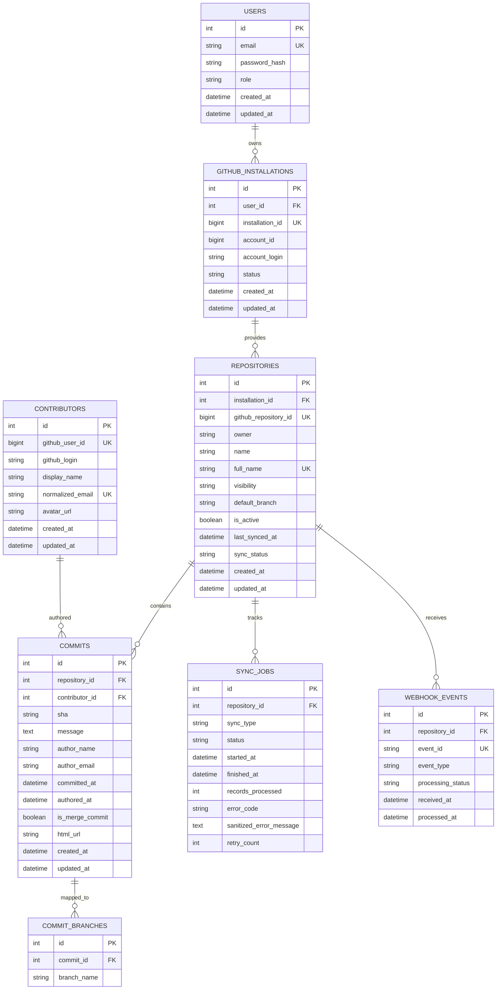

# Database Schema & Entity Relationships

The database is built on SQLAlchemy 2.0 with strict referential integrity, foreign key cascading, and composite indexes designed for efficient time-series querying and deduplication.

## Entity Relationship Diagram

## Indexes & Constraints

1. **Unique Commit Identifier**:
   - `UNIQUE (repository_id, sha)` ensures zero duplicate commits even across repeated or failed sync passes.
2. **Time-Series Query Index**:
   - `INDEX idx_commits_repo_date ON commits (repository_id, committed_at DESC)` ensures near-instantaneous date-filtered lookups and pagination.
3. **Contributor Resolution Index**:
   - `INDEX idx_commits_contributor_date ON commits (contributor_id, committed_at DESC)` optimizes contributor leaderboard queries.
4. **Webhook Deduplication**:
   - `UNIQUE (event_id)` ensures idempotent webhook delivery from GitHub.
