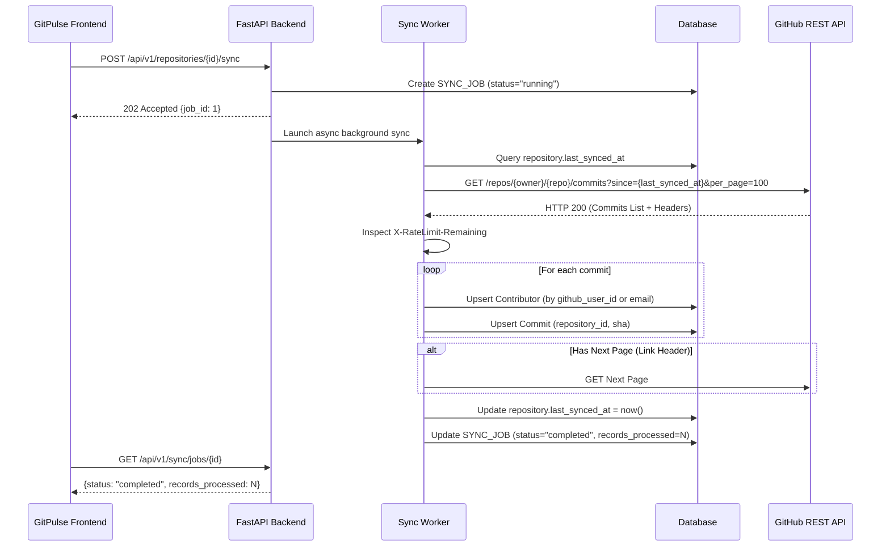

# GitHub Integration & Synchronization Guide

## 1. Authentication Modes

GitPulse supports two authorization modes:

### Mode 1: Personal Access Token (PAT) - Quickstart & MVP
Ideal for single-developer tracking or evaluating the dashboard:
1. Navigate to GitHub Settings -> Developer Settings -> Personal access tokens (Tokens classic or Fine-grained).
2. For fine-grained tokens:
   - Repository access: Select repositories or "All repositories".
   - Repository permissions: `Contents: Read-only`, `Metadata: Read-only`.
3. Set `GITHUB_TOKEN=ghp_...` in `.env`.
4. Rate limit: **5,000 requests/hour** authenticated.

### Mode 2: GitHub App Installation - Organization & Enterprise
Ideal for teams, automated webhook push triggers, and organization-wide multi-repo access:
1. Register a GitHub App under your Organization.
2. Grant Permissions:
   - `Repository contents: Read-only`
   - `Repository metadata: Read-only`
   - Subscribed events: `Push`
3. Generate and download a Private Key (`.pem`).
4. Set in `.env`:
   - `GITHUB_APP_ID=12345`
   - `GITHUB_APP_INSTALLATION_ID=67890`
   - `GITHUB_APP_PRIVATE_KEY_PATH=/path/to/private-key.pem` (or `GITHUB_APP_PRIVATE_KEY` directly)
   - `GITHUB_WEBHOOK_SECRET=your_secret`

---

## 2. Synchronization Lifecycle



---

## 3. Rate Limit & Transient Fault Handling

- **Rate Limit Inspection**: On every GitHub response, the backend reads headers:
  - `X-RateLimit-Limit`
  - `X-RateLimit-Remaining`
  - `X-RateLimit-Reset` (epoch timestamp)
- **Buffer Threshold**: If `remaining < GITHUB_API_RATE_LIMIT_BUFFER` (default: 50), the sync pauses until `Reset` time or aborts gracefully with code `RATE_LIMIT_EXCEEDED`.
- **Exponential Backoff**: Transient errors (HTTP 429, 500, 502, 503, 504) trigger up to 3 retries with jittered exponential delay: `wait = 2^attempt + uniform(0, 1)`.

---

## 4. Webhook Security
Incoming requests to `/api/v1/webhooks/github` are validated using HMAC-SHA256:
```python
signature = request.headers.get("X-Hub-Signature-256")
expected = "sha256=" + hmac.new(webhook_secret.encode(), payload_bytes, hashlib.sha256).hexdigest()
if not hmac.compare_digest(signature, expected):
    raise HTTPException(status_code=401, detail="Invalid signature")
```
Processed idempotently via the unique `X-GitHub-Delivery` GUID recorded in `webhook_events`.
